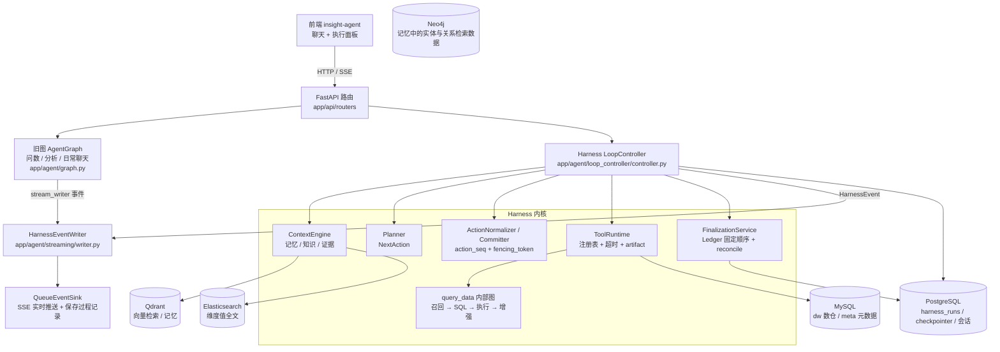
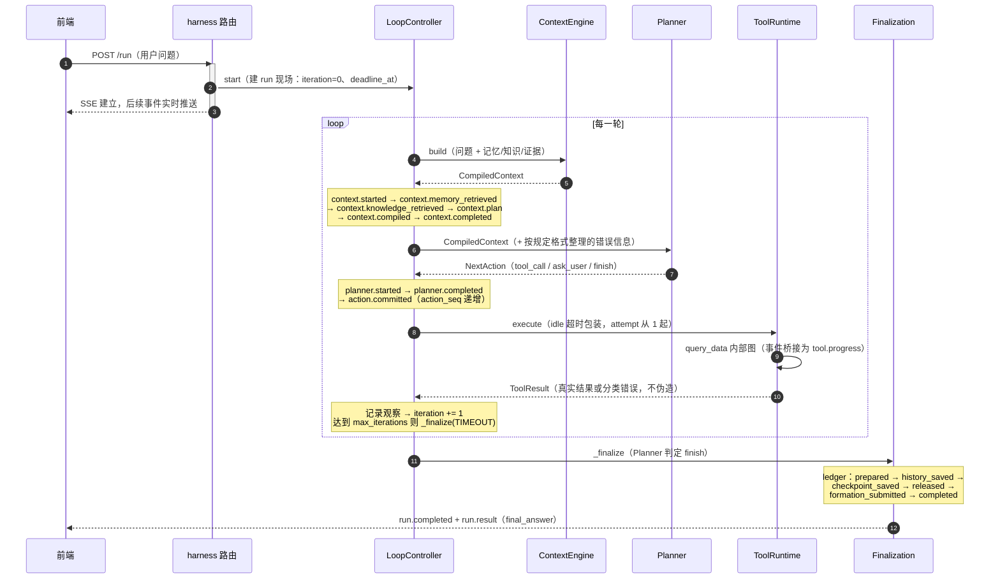
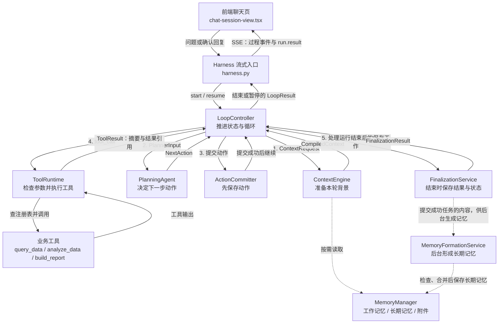

# Data Agent Harness 全量技术文档（as-built）

> **定位**：记录当前代码实际行为的技术文档。每个结论必须带代码引用（项目相对路径 + 函数/步骤号）；与设计文档 SDD（`data_agent_harness_sdd.md` / `data_agent_harness_incremental_sdd.md`）不一致时以代码为准，并在当节标注「与 SDD 偏差：…」。
> **只写现状**：不写"将来会做"、"计划支持"。未实现的能力在疑点清单里登记。
> **内容放在哪里**：整体结构和模块职责写在本文对应章节；节点内部细节（LLM 原始返回等）查看后端日志；完整事件数据查看执行面板的「全部事件」页签。

## 阅读指引

- **初次阅读**：先读第 1 章总览，再按第 2～7 章查阅模块、事件、记忆、前端、配置和测试内容。
- **维护者**：直接查对应模块章节、参考表与附录字段字典。
- **图**：三张图已按代码核对（2026-09-17，关键结论附 `file:line`）；后续代码变更需同步更新图与结论。

---

# 架构与模块概览

以下通过架构图、时序图、状态迁移图和模块章节说明 Harness 的整体结构。

## 1. 总览

### 1.1 架构图（初稿，待校对）



### 1.2 正常路径时序图（已按代码核对）



### 1.3 HarnessStatusType / LoopPhaseStatusType 状态迁移图（已按代码核对）

```mermaid
stateDiagram-v2
    direction TB
    [*] --> RUNNING: run.started（iteration=0）

    state RUNNING {
        [*] --> BUILD_CONTEXT
        BUILD_CONTEXT --> PLAN: context.completed
        PLAN --> PLAN: planner.retrying（重试预算内）
        PLAN --> VALIDATE_ACTION: 产出动作
        PLAN --> COMPLETED: finish 动作（COMPLETED 唯一入口）
        VALIDATE_ACTION --> EXECUTE_TOOL: action.committed（tool_call）
        VALIDATE_ACTION --> PLAN: 校验失败 → 反馈重规划
        VALIDATE_ACTION --> WAITING_CONFIRMATION: ask_user（提交后暂停）
        EXECUTE_TOOL --> EXECUTE_TOOL: 允许重复调用的工具临时失败（attempt+1）
        EXECUTE_TOOL --> HANDLE_TOOL_RESULT: tool.completed / tool.failed
        HANDLE_TOOL_RESULT --> WAITING_CONFIRMATION: 工具返回 NEEDS_USER
        HANDLE_TOOL_RESULT --> RECORD_OBSERVATION: 非确认类结果
        RECORD_OBSERVATION --> BUILD_CONTEXT: iteration += 1<br/>（controller.py:510）
    }

    WAITING_CONFIRMATION --> BUILD_CONTEXT: confirmation.resolved<br/>（resume 后重建上下文重走一轮）

    RUNNING --> TIMEOUT: deadline_at 到期 / 达到 max_iterations
    RUNNING --> CANCELLED: 客户端断开（shield 尝试保护结束保存）
    RUNNING --> FAILED: 未预期异常

    note right of WAITING_CONFIRMATION
        唯一非终态分支：不走 Finalization Ledger。
        两个进入点：planner ask_user（VALIDATE_ACTION 后）、
        工具返回 NEEDS_USER（HANDLE_TOOL_RESULT 后）。
        恢复不原地续跑：从 BUILD_CONTEXT 重走一轮。
    end note
    note bottom of COMPLETED
        四种终态统一经 _finalize 处理（phase=FINALIZATION）：
        按固定顺序保存结果并记录进度，解除 active_run 占用
    end note
```

> **已核对（2026-09-17）**，原三个待校对点的结论：
> ① 恢复不是从暂停处接着执行：`resume()` 在同一个数据库事务中保存用户回复并将确认标为已处理，然后通过 `_run_guarded` 重新进入 `_run`，回到 `BUILD_CONTEXT` 准备上下文、重新规划（controller.py:137-181、336-342）；用户答复已写入 state，Planner 可以从输入中读到。`confirmation.resolved` 事件的 phase 为 `RESTORE_RUN`（controller.py:159-165）。
> ② `max_iterations` 检查在 RECORD_OBSERVATION 阶段、`iteration += 1` 与保存现场之后（controller.py:510-519），达到即 `_finalize(TIMEOUT)`——终态是 **TIMEOUT** 而非 FAILED。
> ③ `COMPLETED` 只从 FINAL_ANSWER 处理分支进入（controller.py:423）；`_finalize` 默认 `terminal_status=COMPLETED`（controller.py:1013），其余全部调用点均显式指定 FAILED / CANCELLED / TIMEOUT。
>
> 另注：LoopPhaseStatusType 还有三个未在图中单独画成步骤的值：`START_RUN`（start 入口事件，controller.py:126）、`RESTORE_RUN`（准备恢复或中断所需的运行状态）、`FINALIZATION`（保存结果、处理运行结束）。

### 1.4 术语表

<!-- 逐条补充：run / turn / thread、iteration、NextAction、action、action_seq、attempt、fencing_token、ledger stage、CompiledContext、ToolResult、observation -->


| 术语     | 含义                                                                                                                                       | 定义位置              |
| -------- | ------------------------------------------------------------------------------------------------------------------------------------------ | --------------------- |
| Artifact | 保存工具完整结果的记录，存放在 `harness_artifacts` 表中。编号根据运行、动作和结果内容生成；模块之间传递的是结果引用 `result_ref`，需要完整内容时，再通过 ArtifactStore 按引用读取，并检查它是否属于当前运行。 | app/models/harness.py::HarnessArtifactModel；app/repositories/harness_artifact_repository.py::PostgresResultArtifactStore |

---

## 2. 项目目录与 Harness 核心模块

### 2.1 项目文件目录

本章只沿新 Harness 的流式主链阅读：发送问题走 `/api/harness/run/stream`，确认后继续走 `/api/harness/run/resume/stream`。下面列出这条链路及其必要支撑文件；业务工具只看到调用边界，不展开内部业务节点。

目录是阅读地图，不是仓库所有文件的清单。省略包初始化文件、依赖目录、缓存、模型权重和运行数据；文件后的注释说明它在当前链路中的作用。

```text
ai_data_analysis/
|-- app/                                      # Python 后端
|   |-- main.py                               # FastAPI 启动、客户端生命周期、挂载 /api 路由
|   |-- api/
|   |   |-- router.py                         # 汇总并注册当前启用的 API 路由
|   |   `-- routers/
|   |       |-- harness.py                    # 流式请求入口；组装控制器、启动/恢复运行、输出 SSE
|   |       `-- conversations.py              # 创建会话、查询会话列表和历史消息/输出
|   |-- agent/
|   |   |-- state.py                          # AgentState 与 HarnessRunState 的数据结构
|   |   |-- context.py                        # 业务工具使用的 LLM、检索、Meta/DW 等依赖包
|   |   |-- daily_chat_agent.py               # 使用整理好的消息生成日常聊天答案
|   |   |-- loop_controller/
|   |   |   |-- controller.py                 # 主循环：准备上下文、规划、提交、执行、暂停和结束处理
|   |   |   |-- contracts.py                  # 启动/恢复参数、运行结果，以及其他模块需提供的方法
|   |   |   `-- action_commit.py              # 动作提交请求、提交结果和 ActionCommitter 接口
|   |   |-- context_engine/
|   |   |   |-- factory.py                    # 创建上下文引擎及其内部组件
|   |   |   |-- engine.py                     # 按顺序准备上下文，并记录处理过程
|   |   |   |-- contracts.py                  # ContextRequest、Policy、候选、CompiledContext 等结构
|   |   |   |-- interfaces.py                 # 规定记忆读取、摘要、检索和计数需要提供哪些方法
|   |   |   |-- harness_context.py            # 从 Harness state 取出所需内容，组成 ContextRequest
|   |   |   |-- harness_context_contracts.py   # 运行背景的数据结构：条件、进展、工具结果摘要和错误
|   |   |   |-- resolver.py                   # 解析会话/附件指代，校验附件归属
|   |   |   |-- planner.py                    # 决定去哪里查找背景，不决定下一步业务动作
|   |   |   |-- history.py                    # 划分近期原文与较早历史，维护增量摘要
|   |   |   |-- summarizer.py                 # 合并历史摘要；LLM 失败时改用保留、截短原文的方式
|   |   |   |-- deduplicator.py               # 选择同一内容的合适版本，去掉重复内容
|   |   |   |-- selector.py                   # 按评分、必要性和预算选择候选
|   |   |   |-- compressor.py                 # 只为本轮输入按 token 边界截短候选
|   |   |   |-- compiler.py                   # 将系统指令、运行背景、证据和历史组装成模型消息
|   |   |   |-- token_counter.py              # token 计数、截断和分批切分
|   |   |   `-- errors.py                     # 定义 ContextBudgetExceeded 超预算异常
|   |   |-- planning_agent/
|   |   |   |-- agent.py                      # 生成并校验下一步动作，衔接日常聊天分支
|   |   |   |-- contracts.py                  # 模型草稿、生成动作编号所需的信息和模型调用方法
|   |   |   |-- validator.py                  # 检查动作能力、工具名称和入参要求
|   |   |   |-- normalizer.py                 # 将已校验草稿转换为待提交的 NextAction
|   |   |   |-- action_id.py                  # 由服务端运行身份和序号生成工具动作 ID
|   |   |   `-- errors.py                     # 规划失败类型，以及可返回的错误信息格式
|   |   |-- state_result_store/
|   |   |   |-- contracts.py                  # 身份、状态枚举、PlannerInput、NextAction、ToolResult
|   |   |   `-- state.py                      # 初始控制状态、合法阶段迁移和状态编解码
|   |   |-- tool_runtime/
|   |   |   |-- registry.py                   # 工具名到 ToolSpec 与实现的注册表
|   |   |   |-- runtime.py                    # 校验入参、限时执行、保存完整结果、返回 ToolResult
|   |   |   |-- contracts.py                  # 工具执行时需要的参数及其数据格式
|   |   |   `-- artifacts.py                  # 完整工具结果的保存、读取方法及结果引用格式
|   |   |-- business_tools/                   # 当前注册的三个业务能力，仅列工具边界
|   |   |   |-- query_data/tool.py            # 查询数据的工具入口，返回摘要和完整查询输出
|   |   |   |-- query_data/contracts.py       # 问数工具入参和出参
|   |   |   |-- analyze_data/tool.py          # 分析数据的工具入口，返回任务结果与证据
|   |   |   |-- analyze_data/contracts.py     # 分析工具入参和出参
|   |   |   |-- build_report/tool.py          # 按引用读取此前的工具结果，生成可展示的报告
|   |   |   `-- build_report/contracts.py     # 报告工具入参和出参
|   |   |-- finalization/
|   |   |   |-- service.py                    # 结束时保存历史和最终状态、解除占用、提交记忆生成任务
|   |   |   `-- errors.py                     # 结束处理失败时保留进度，方便后续继续完成
|   |   |-- streaming/
|   |   |   |-- contracts.py                  # Harness 事件名称、数据格式和事件接收器需提供的方法
|   |   |   `-- writer.py                     # 统一事件出口、队列 sink、SSE 帧与结束标记
|   |   |-- memory/
|   |   |   |-- factory.py                    # 组装应用级 MemoryRuntime
|   |   |   |-- manager.py                    # 统一提供工作记忆、长期记忆、附件和来源的读写方法
|   |   |   |-- interfaces.py                 # 记忆记录、来源、读取与存储接口
|   |   |   |-- contracts.py                  # 生成记忆时的输入、待保存内容和检查结果等数据结构
|   |   |   |-- types/working.py              # 从会话消息读取工作记忆，过滤超预算 turn
|   |   |   |-- types/semantic.py             # 稳定事实、偏好和规则的长期记忆
|   |   |   |-- types/episodic.py             # 过去任务与处理经验的长期记忆
|   |   |   |-- types/perceptual.py           # 附件相关内容的长期记忆
|   |   |   |-- formation_service.py          # 接收成功轮次，调度后台记忆形成
|   |   |   |-- governance.py                 # 检查记忆能否保存，以及是否需要合并或替换旧记忆
|   |   |   `-- writer.py                     # 将通过检查的记忆交给 MemoryManager 保存
|   |   `-- prompts/
|   |       |-- prompt_loader.py              # 按名称加载提示词模板
|   |       `-- plan_next_action.prompt       # 下一步动作规划的提示词模板
|   |-- repositories/                         # 具体数据库读写，不负责推进主循环
|   |   |-- conversation_repository.py        # 会话、turn、消息、最终输出、执行轨迹与占用
|   |   |-- harness_run_repository.py         # 运行快照，以及确认暂停/恢复的事务
|   |   |-- harness_action_repository.py      # 动作提交、序号和版本检查
|   |   |-- harness_artifact_repository.py    # 完整工具结果与报告的 PostgreSQL 存取
|   |   |-- finalization_repository.py        # 记录结束处理已完成哪些步骤，方便中断后继续
|   |   |-- context_repository.py             # 保存会话摘要，以及上下文的准备过程和结果
|   |   `-- memory/                           # 保存长期记忆原始记录，以及 Qdrant/Neo4j 检索数据
|   |-- models/                               # ORM 表结构；与 repositories 的读写实现分开
|   |   |-- agent_history.py                  # conversations、turns、messages、outputs
|   |   |-- harness.py                        # runs、actions、confirmations、artifacts、finalizations
|   |   |-- context_engine.py                 # context_conversation_summaries 与 context_build_runs
|   |   `-- memory.py                         # 长期记忆、附件、来源、生成任务与检索数据处理记录等表
|   |-- clients/                              # LLM、Embedding、数据库和检索客户端生命周期
|   |   |-- memory_client.py                  # 初始化并持有 MemoryRuntime，关闭时等待后台任务
|   |   `-- postgres_client.py                # 主链共用的 PostgreSQL 连接池、会话工厂与建表
|   `-- core/
|       |-- config.py                         # 读取 config.yaml 和环境变量，生成 settings
|       `-- logging.py                        # 日志级别、格式和控制台颜色
|-- frontend/                                 # Next.js 前端
|   |-- app/
|   |   |-- page.tsx                          # 新建会话页面入口
|   |   `-- sessions/[id]/page.tsx            # 指定会话的聊天详情页入口
|   |-- components/insight-agent/
|   |   |-- home-view.tsx                     # 创建会话并进入详情页
|   |   |-- chat-session-view.tsx             # 发送问题、接收 SSE 事件、处理确认和加载历史
|   |   |-- chat-run-progress.tsx             # 聊天气泡内的运行摘要与步骤进度
|   |   |-- execution-panel.tsx               # 按运行事件展示过程和上下文快照
|   |   `-- analysis-workspace.tsx            # 展示结构化分析报告与图表
|   |-- services/
|   |   |-- harness.ts                        # streamRun、streamResume 等 Harness API 封装
|   |   |-- request.ts                        # 发送 HTTP 请求、读取 SSE 事件和处理错误
|   |   `-- conversations.ts                  # 会话创建、列表和历史查询 API 封装
|   |-- types/insight-agent.ts                # 前端共享的业务数据类型
|   |-- next.config.ts                        # 将 /api 请求代理到 FastAPI
|   `-- package.json                          # 前端依赖与开发、构建、类型检查命令
|-- scripts/
|   |-- postgres/                             # 会话、记忆、ContextEngine、Harness 建表 SQL
|   `-- mysql/                                # 数据仓库和元数据的初始化/校验 SQL
|-- docker/docker-compose.yml                 # 配置并启动本地数据库等服务
|-- tests/                                    # 主循环、上下文、规划、工具、流式 API 等测试
|-- docs/                                     # 实建文档、设计基线与任务记录
|-- config.yaml                               # 应用、模型、存储、检索和 Harness 运行限制等配置
`-- pyproject.toml                            # Python 版本、后端依赖与测试/检查配置
```

**按层找代码**：请求怎么进来，先看 `api/routers/harness.py`；执行走到哪里，看 `loop_controller/controller.py`；背景怎么装进模型，看 `context_engine/`；下一步动作怎么产生，看 `planning_agent/`；数据存在哪里，看 `repositories/` 与 `models/`。这些后端路径均位于 `app/` 下，具体数据流从 2.3 开始展开。

### 2.2 模块协作关系图

下图表示流式运行中模块之间的调用和数据返回。实线是主执行链路，虚线是记忆读取或成功任务的记忆形成；没有把每张数据库表、工具内部节点都画成一个流程步骤。



**沿数据流读图**：

1. 前端发送问题后，入口准备身份、事件队列和各模块依赖，保存用户消息，再启动主循环。确认回复则恢复同一个 run，不另建 turn。代码：`frontend/services/harness.ts::harnessService.streamRun/streamResume`；`app/api/routers/harness.py::run_harness_stream()`、`resume_harness_stream()`。
2. 主循环先让 ContextEngine 准备背景，再把 `CompiledContext + 运行视图 + 工具声明` 交给 PlanningAgent。两者不是串行调用对方，而是都由主循环调度。代码：`app/agent/loop_controller/controller.py::LoopController._build_context()`、`_planner_input()`、`_plan_action()`。
3. PlanningAgent 返回 `NextAction` 后，仍先回到主循环，动作提交成功才允许执行。ActionCommitter 不直接调用工具；需要执行工具时，由主循环调用 ToolRuntime。代码：`app/agent/loop_controller/controller.py::LoopController._commit_action()`、`_run()` ⑧～⑩。
4. 工具输出由 ToolRuntime 保存为 Artifact，返回摘要和引用。主循环将 `ToolResult` 整理成 observation，也就是留给下一轮参考的工具执行记录；普通结果经过迭代计数后回到 ContextEngine，再按“工具结果 → 新上下文 → 再规划”的顺序继续。代码：`app/agent/tool_runtime/runtime.py::ToolRuntime.execute()`；`app/agent/loop_controller/controller.py::LoopController._run()` ⑪～⑭。
5. `ask_user` 或工具 `needs_user` 会暂停运行：主循环保存待确认的问题和当前运行状态，通过 SSE 提示用户；收到回复后重新准备上下文。`final_answer` 或运行中断时，则由 FinalizationService 保存结果与最终状态，完成后控制器才发出对应的结束事件。代码：`app/agent/loop_controller/controller.py::LoopController._pause_for_confirmation()`、`resume()`、`_finalize()`。
6. 记忆分为读取和生成两部分：ContextEngine 在运行中读取已有背景；运行成功结束时，FinalizationService 提交记忆生成任务，后台从本轮内容中提取记忆、检查是否需要保存，再写入长期记忆。会话摘要则由 ContextEngine 的 history 组件维护，不由这个后台任务生成。代码：`app/api/routers/harness.py::_build_controller()`；`app/agent/context_engine/history.py::ConversationHistoryManager._update_summary()`；`app/agent/finalization/service.py::PostgresFinalizationService._submit_formation()`；`app/agent/memory/formation_service.py::MemoryFormationService.submit()`、`process()`。

**图中未展开的支撑关系**：

| 支撑模块 | 谁使用、数据往哪里走 |
| --- | --- |
| 运行与确认存储 | LoopController 通过 `PostgresHarnessRunStore` 保存运行快照、暂停和恢复；对应 `harness_runs`、`harness_confirmations`。代码：`app/repositories/harness_run_repository.py`。 |
| 动作与结果存储 | ActionCommitter 保存 `harness_actions`；ToolRuntime 经 ArtifactStore 保存 `harness_artifacts`，报告工具和结束处理服务凭运行身份、按引用读取结果。代码：`app/repositories/harness_action_repository.py`、`app/repositories/harness_artifact_repository.py`；`app/agent/business_tools/build_report/tool.py::BuildReportTool.execute()`。 |
| 上下文相关记录 | ContextEngine 经 `PostgresContextRepository` 读写会话摘要，以及上下文的准备过程和结果；MemoryManager 提供历史消息、长期记忆及附件的读取方法。代码：`app/agent/context_engine/factory.py::build_context_engine()`；`app/repositories/context_repository.py`；`app/agent/memory/manager.py`。 |
| 会话历史与结束处理进度 | 入口先保存 user 消息；FinalizationService 经会话仓储保存 assistant 消息和输出，并由 ledger 记录结束处理已完成哪些步骤，方便中断后继续。代码：`app/api/routers/harness.py::run_harness_stream()`；`app/agent/finalization/service.py::PostgresFinalizationService._drive()`、`_save_history()`。 |
| 事件通道 | 控制器、ToolRuntime 和业务工具将事件交给 `HarnessEventWriter → QueueEventSink → queue`，入口 `_sse_response()` 再推给前端；事件展示不替代运行快照。代码：`app/agent/streaming/writer.py`；`app/api/routers/harness.py::_sse_response()`。 |

### 2.3 Harness 接收请求与组装运行流程

**主要内容**：接收前端的流式请求，准备本次运行的身份、数据库会话和各模块依赖，再把用户问题交给 `LoopController`。执行期间通过 SSE 返回进度与结果，用户确认后仍通过流式接口恢复；入口不负责决定下一步调用哪个工具。

**主要代码**：`app/api/routers/harness.py`。下列入口的完整路径均以 `/api/harness` 开头。

```text
用户问题 → 检查请求参数 → 准备运行身份和依赖 → 组装 LoopController
        → 保存本轮用户消息 → controller.start() → SSE 过程事件与本次结果
```

#### 功能 1：接收用户问题，检查运行依赖

`run_harness_stream()` 接收 `POST /run/stream` 请求，用 `HarnessRunRequest` 校验输入：

| 输入字段 | 作用 |
| --- | --- |
| `input_text` | 本轮用户问题，长度为 1～20,000 个字符；这是字符限制，不是 token 预算。 |
| `user_id` | 数据归属与隔离使用的用户标识；当前仍由请求携带或使用默认值，尚不是登录认证取得的身份。 |
| `conversation_id` | 指定继续哪个会话；未传时由入口生成新 ID。 |
| `asset_ids` | 本轮附件 ID，入口去重后继续传递。 |

请求通过字段校验后，`_require_runtime()` 取得应用启动时初始化的 Memory Runtime、PostgreSQL 会话工厂和 LLM 客户端；入口还检查 Meta、DW 两套 MySQL 会话工厂。依赖未初始化时停止启动，不进入主循环。HTTP 请求中目前没有 `token_budget` 字段。

代码：`app/api/routers/harness.py::HarnessRunRequest`、`_require_runtime()`、`run_harness_stream()`；路由前缀挂载见 `app/api/router.py`、`app/main.py`。

#### 功能 2：准备运行身份，建立流式事件通道

入口把用户与会话信息组成 `HarnessRunRef`，后续控制器、工具、结果仓储都使用这组身份关联数据。

| 身份字段 | 本次如何取得 |
| --- | --- |
| `user_id` | 来自请求。 |
| `conversation_id` | 沿用请求中的会话 ID，或新建 UUID。 |
| `thread_id` | 当前设为 `conversation_id`。 |
| `turn_id` | 新建 UUID，表示本轮用户任务；其中可以包含多次工具迭代。 |
| `run_id` | 新建 UUID，表示本次 Harness 运行。 |

入口再创建 `queue → QueueEventSink → HarnessEventWriter`：控制器和工具通过 writer 发出事件，sink 将事件放入队列并留存轨迹，SSE 从队列读取。这里是对象创建顺序，事件流动方向则是 `writer → sink → queue → SSE`。

代码：`app/api/routers/harness.py::run_harness_stream()`、`_build_controller()`；`app/agent/streaming/writer.py::QueueEventSink`、`HarnessEventWriter`。

#### 功能 3：创建各模块，再交给 LoopController 使用

入口先在请求作用域内打开 Meta、DW 数据库会话，再传给 `_build_controller()` 按以下顺序组装对象。这里是在准备执行能力，还没有开始查询数据或调用规划器。

| 创建顺序 | 组装内容 | 交给谁使用 |
| --- | --- | --- |
| 1 | 三个 `ToolSpec`，声明 `query_data`、`analyze_data`、`build_report` 的入参、超时和结果类型。 | PlanningAgent 了解可选工具，ToolRuntime 按这些要求检查和执行。 |
| 2 | `PostgresResultArtifactStore`，保存和读取完整工具结果。 | ToolRuntime、报告工具、结束处理服务。 |
| 3 | `_agent_context()`，汇集 LLM、Embedding、Qdrant、Elasticsearch、Meta/DW 仓储等业务依赖。 | 三个业务工具通过这组依赖完成问数、分析和报告。 |
| 4 | 工具实例与 `ToolRegistry`，再构造 `ToolRuntime`。 | 主循环按工具名调用统一执行入口。 |
| 5 | `build_context_engine()`，传入记忆读取对象、PostgreSQL 和 LLM。 | 主循环准备本轮上下文，详见 2.5。 |
| 6 | `PostgresHarnessRunStore` 和 `PostgresFinalizationService`；后者使用会话读写、结束处理进度记录、Artifact 读写及记忆生成服务。 | 保存运行状态，并在结束时保存结果、解除会话占用。 |
| 7 | 把 `PlanningAgent`、`DailyChatAgent`、`HarnessContextRequestFactory`、`PostgresActionCommitter` 与前述对象一起传给 `LoopController`。 | 让主循环具备启动、暂停和结束处理所需的能力。 |

组装时还传入系统指令、规划/工具重试上限、最大迭代数、运行超时和事件 writer。当前 `confirmation_dispatcher=None`，因此需要用户补充条件时会保存当前状态并暂停，等待用户回复，不会在服务器内部立即代答。`DailyChatAgent` 已接入 PlanningAgent，普通聊天也从这套 Harness 入口进入。

代码：`app/api/routers/harness.py::_build_controller()`、`_agent_context()`、`_query_tool_spec()`、`_analyze_tool_spec()`、`_report_tool_spec()`。

#### 功能 4：先保存用户这一轮，再启动主循环

控制器组装成功后，入口调用 `ConversationRepository.start_turn()`，在一个 PostgreSQL 事务中准备会话、创建 `status=running` 的 turn、保存 `sequence_no=0` 的 user 消息，并设置会话的 `active_run_id`。已有尚未结束的运行占用同一会话时，不允许再启动新运行；代码也会检查并清理已结束或不存在的运行留下的占用。

随后入口构造 `StartRunCommand(run_ref, input_text, asset_ids)`，调用 `controller.start()`。`harness_runs` 的初始运行快照由控制器在 `start()` 中创建，不是 `start_turn()` 创建。

因此，新请求的顺序是：**组装控制器 → 保存 turn 和用户消息 → 创建 Harness 运行快照 → 进入循环**。运行快照就是把当前运行状态完整保存下来，方便后续读取或恢复。创建会话历史和创建运行快照不是同一个数据库事务，入口提供 `_finish_unhandled_start_failure()` 清理未被控制器处理的启动异常。

代码：`app/api/routers/harness.py::run_harness_stream()`、`_finish_unhandled_start_failure()`；`app/repositories/conversation_repository.py::ConversationRepository.start_turn()`；`app/agent/loop_controller/controller.py::LoopController.start()`。

#### 功能 5：通过 SSE 持续返回过程事件和本次结果

`_sse_response()` 建立后台执行任务，把队列中的事件转换成 SSE 格式，持续返回前端；没有新事件时发送心跳。主循环在后台执行，异步生成器则不断从队列读取事件，写入 HTTP 响应。

控制器返回后，入口用 `_serialize_result()` 把 `LoopResult` 中规定的字段转换成可返回的数据，补发 `run.result`。**返回结果既可能是已结束，也可能是等待用户确认；收到 `run.result` 不等于任务已经完成。** 运行完成、失败、超预算等结束事件，要等结果和最终状态保存成功后，才由控制器发出。

流式操作退出时，入口尝试把 sink 留存的事件写入 `turn_outputs` 的执行轨迹；这次保存不计入 FinalizationService 的结束处理进度。客户端断开时会取消后台执行任务；如果任务已经进入 `_run_guarded()`，控制器会尝试保存 `cancelled` 状态并完成结束处理。流式操作异常会记录日志并发出 `stream.failed`，必要时调用启动失败清理函数。

代码：`app/api/routers/harness.py::_serialize_result()`、`_sse_response()`；`app/repositories/conversation_repository.py::ConversationRepository.save_execution_trace()`。

#### 功能 6：收到确认回复后，在同一个 run 上恢复流式运行

前端把确认回复发给 `POST /run/resume/stream`，由 `resume_harness_stream()` 接收。这是暂停之后的分支，不会再次调用 `start_turn()` 创建一轮用户任务。

1. 用 `run_id + user_id` 读取服务端快照，从快照恢复完整运行身份和附件，不接受客户端覆盖 conversation、turn 或 thread。
2. 把确认 ID、答案、确认/拒绝决策和条件组成 `ConfirmationReply`，重新建立本次请求的队列、sink、writer 和控制器。
3. 调用 `controller.resume(ResumeRunCommand(...))`，沿用原 run、turn、thread；具体如何处理回复和重新准备上下文见 2.4 功能 8。
4. 复用 `_sse_response()` 推送恢复后的事件与 `run.result`，暂停前的 SSE 连接不需要一直保留。

SSE 建立前的入口异常经 `_http_error()` 转为 HTTP 错误，例如权限错误为 403、运行不存在为 404、数据保存或状态冲突通常为 409。SSE 已开始后的执行异常则通过 `stream.failed` 等事件表达。查询运行状态、检查并继续未完成的结束处理属于辅助能力，本章不展开其请求方式。

代码：`app/api/routers/harness.py::resume_harness_stream()`、`_run_ref_from_state()`、`_sse_response()`、`_http_error()`。

### 2.4 LoopController 主循环

**主要内容**：接过入口准备好的参数和各模块，反复执行“准备上下文 → 决定下一步 → 保存动作 → 执行或暂停”。每次工具执行后，都把结果摘要留给下一轮参考；任务完成、失败、超时或超预算时，交给 FinalizationService 保存结果和最终状态。

**主要代码**：`app/agent/loop_controller/controller.py::LoopController`。入口只负责创建它并传入所需对象，真正的循环在 `_run()` 中。

```text
start → 创建运行快照 → BUILD_CONTEXT → PLAN → VALIDATE_ACTION → 提交动作
  ├─ final_answer → FINALIZATION → 返回运行结束结果
  ├─ ask_user     → WAIT_CONFIRMATION → 返回暂停结果
  └─ tool_call    → EXECUTE_TOOL → HANDLE_TOOL_RESULT
                       ├─ needs_user → WAIT_CONFIRMATION
                       └─ 记录观察 → iteration + 1 → 重建上下文 → PLAN
```

#### 功能 1：根据启动参数创建初始运行状态

`start()` 收到 `StartRunCommand` 后，先调用 `_new_state()`。外层 state 保存用户问题、完整运行身份、项目和附件；`state["harness"]` 保存主循环的控制信息。

新运行从 `status=running`、`phase=start_run`、`iteration=0`、`action_seq=0` 开始，并记录原始目标、最大迭代数、`started_at` 和绝对时间 `deadline_at`。随后 `run_store.create()` 把现场写入 `harness_runs`，发出 `run.started`，再进入 `_run_guarded()`。

`status` 表示整次运行目前是运行、等待还是已结束，`phase` 表示正在执行哪一步。后续 `_transition()` 调用状态转换函数，检查是否允许进入下一个阶段，并更新状态版本号 `state_version`，再由 `_save_running_state()` 保存；这不只是修改前端展示的标签。

代码：`app/agent/loop_controller/controller.py::LoopController.start()`、`_new_state()`、`_transition()`、`_save_running_state()`；`app/agent/state_result_store/state.py::new_harness_control_state()`、`transition_harness_state()`。

#### 功能 2：进入 BUILD_CONTEXT，为规划准备背景

`_run()` 先检查是否超过运行截止时间，再进入 `build_context` 阶段并保存状态，随后调用 `_build_context()`。后者用 `HarnessContextRequestFactory.create()` 从 state 中取出所需内容，组成 `ContextRequest`，交给 `ContextEngine.build()`，具体过程见 2.5。

拿到 `CompiledContext` 后，控制器把 `build_id` 和 token 数保存到 `last_context_build_id`、`last_context_token_count`，并发出 `context.*` 事件，说明找到了哪些记忆、准备去哪里查找背景，以及最终整理出的上下文。失败时补发 `context.failed`，再把异常交给 `_run_guarded()` 处理。

这里的职责分工是：**ContextEngine 返回整理好的上下文，以及内容查找、筛选的过程记录；LoopController 再据此更新运行状态、发出事件。** `context.plan` 等成功事件是在构建返回后发出，不是引擎每做一步就直接推送一个事件。

代码：`app/agent/loop_controller/controller.py::LoopController._run()` ①②、`_build_context()`、`_context_snapshot()`。

#### 功能 3：进入 PLAN，把上下文与运行进展一起交给规划器

上下文准备好后，`_run()` 进入 `plan` 阶段并保存状态，再调用 `_planner_input()` 组装 `PlannerInput`：

| 输入组成 | 本轮实际传入的内容 | 用途 |
| --- | --- | --- |
| `compiled_context` | ContextEngine 整理好的消息、分类内容、token 数和处理记录。 | 说明本轮已经准备好的背景和证据。 |
| `state_view` | 原始目标、当前迭代数、已有的全部工具执行记录（摘要和引用等）和最近错误。 | 告诉规划器做过什么、得到什么、哪里失败。 |
| `tool_specs` | 入口注册的工具声明。 | 限定下一步可以调用的工具及其参数。 |

`_plan_action()` 再把 `run_id`、当前 `iteration`、下一动作的序号 `action_seq=已提交序号+1` 组成 `ActionIssuanceContext`，交给 `PlanningAgent.plan()`，用于确定动作编号等信息。PlanningAgent 决定下一步做什么，返回 `NextAction`；LoopController 自己不生成模型提示词或业务答案。

这里有两点需要区分：`_planner_input()` 当前没有填入 `state_view.plan_progress`，该字段使用默认值；但 2.5 中整理运行背景的代码会读取 `plan_progress`。另外，这里的规划是决定“接下来做什么”，2.5 中的规划只决定“先找哪些背景”，不是同一件事。

代码：`app/agent/loop_controller/controller.py::LoopController._run()` ③④、`_planner_input()`、`_plan_action()`；`app/agent/state_result_store/contracts.py::PlannerInput`、`PlannerStateView`；`app/agent/planning_agent/agent.py::PlanningAgent.plan()`。

#### 功能 4：处理规划失败，拦截不能继续的重复动作，再提交

规划抛出 `PlannerFailure` 时，`_handle_planner_failure()` 记录 `last_error`。如果错误允许重试且未达到上限，就增加计数，用**同一份 CompiledContext 加上最新错误**重新组装 Planner 输入；此时不重新准备上下文，也不增加工具迭代次数。不能重试或次数用完时，结束运行并保存 `failed` 状态。

拿到动作后，控制器清理本阶段的规划重试计数，进入 `validate_action`。在提交前先检查：是否重复了已失败的相同工具请求，是否再次提出已处理的相同确认或超过确认次数上限。命中则停止，避免留下已提交却不会执行的动作。

通过检查后，`_commit_action()` 校验动作序号，把动作交给 `PostgresActionCommitter.commit()`。它先锁住对应的数据库运行记录，避免同时修改；再检查运行身份、动作序号是否连续、动作内容是否相同，以及状态版本号 `state_version`。检查通过后，在同一个事务中写入 `harness_actions`，并更新 `harness_runs` 的动作序号。只有返回 `committed`（本次保存成功）或 `idempotent`（相同动作已保存，不再重复写入），控制器才继续处理。

**与 SDD 偏差**：设计文档 `docs/data_agent_harness_incremental_sdd.md` 的 3.4.2 要求按 `prepared → checkpoint → committed` 分步保存；当前代码是在单个 PostgreSQL 事务中直接保存 `committed`。提交请求虽然携带 `expected_checkpoint_revision`（预期的状态保存版本）和 `execution_fence`（区分执行资格新旧的凭证），但 PostgreSQL 提交器尚未检查这两项，不能说已经完整实现了阻止旧执行者继续提交的保护。保存动作与实际调用工具也不在同一个事务中，动作保存成功不代表工具绝不会重复执行。

代码：`app/agent/loop_controller/controller.py::LoopController._handle_planner_failure()`、`_has_failed_tool_request()`、`_should_stop_for_repeated_confirmation()`、`_commit_action()`；`app/repositories/harness_action_repository.py::PostgresActionCommitter.commit()`。

#### 功能 5：按动作类型，选择结束、暂停或执行工具

| `NextAction.action_type` | 控制器接下来的处理 | 输出或下一站 |
| --- | --- | --- |
| `final_answer` | 把答案交给 `_finalize()`。 | FinalizationService 成功后返回 `LoopRunResult`。 |
| `ask_user` | 当前入口没有传入立即处理确认的对象，调用 `_pause_for_confirmation()`。 | 保存待确认信息，返回 `LoopPausedResult`；只是暂停，不按任务结束处理。 |
| `tool_call` | 进入 `execute_tool` 阶段、保存状态，再调用 `_execute_tool()`。 | ToolRuntime 执行工具，返回 `ToolResult`。 |

正式动作只有这三种。日常聊天产生的答案最终也以 `final_answer` 进入控制器，而不是增加一个 `daily_chat` 执行动作。流式主链使用入口传入的 ActionCommitter，先保存动作，再根据动作类型决定接下来怎么处理。

代码：`app/agent/loop_controller/controller.py::LoopController._run()` ⑥～⑩；`app/agent/planning_agent/agent.py::PlanningAgent.plan()`；`app/agent/state_result_store/contracts.py::ActionType`。

#### 功能 6：执行工具，把结果整理成下一轮可参考的记录

`_execute_tool()` 把运行身份、已提交动作序号、工具调用、迭代数和 `attempt` 传给 ToolRuntime。重试同一动作时增加 `attempt`，不重新提交一个动作。只有工具返回可重试的 `temporary_error`、工具声明为 `idempotent`（允许安全地重复调用）、超时重试策略允许且仍有次数时，才会自动重试；不是所有异常都重试。

得到结果后，主循环进入 `handle_tool_result`，把结果整理成 `RunObservation`。这份记录包含工具名、状态、摘要、结果引用 `result_ref`、证据引用、限制，以及用于比较输出和请求是否相同的哈希值；同时更新 `last_error`。完整工具结果不复制进 observation，需要查看时再按 Artifact 引用读取。

这份工具执行记录会先追加到 state，再检查结果是否为 `needs_user`。如果需要用户确认，就连同这条记录一起保存当前状态并暂停，**此时尚未执行 `iteration += 1`**；普通结果才进入下一步记录与计数。

代码：`app/agent/loop_controller/controller.py::LoopController._execute_tool()`、`_tool_error()`、`_run()` ⑪⑫；`app/agent/state_result_store/contracts.py::RunObservation`。

#### 功能 7：记录本轮执行，带着新结果重新准备上下文

不需要用户确认的工具结果进入 `record_observation`，`iteration += 1` 后保存状态。达到 `max_iterations` 就结束运行并保存 `timeout` 状态，不再启动下一次规划。

未达到上限时，主循环回到 `build_context`，用已经加入新工具执行记录的 state 再调用 ContextEngine，然后重新进入 `plan`、组装 Planner 输入。这样规划器才能根据已获得的结果决定继续查询、分析、生成报告还是直接回答，不会每次都从空白开始。

`iteration` 主要计数已走完记录阶段的工具迭代，`action_seq` 计数已提交动作，`attempt` 计数同一工具动作的执行尝试；三者不能混用。日常聊天直接回答、等待确认、规划重试都不必增加 `iteration`。

代码：`app/agent/loop_controller/controller.py::LoopController._run()` ⑬⑭、`_execute_tool()`、`_commit_action()`。

#### 功能 8：需要用户补充时保存状态，收到回复后重新准备上下文

`_pause_for_confirmation()` 生成带过期时间的确认凭证，通过 run store 在同一个 PostgreSQL 事务中保存待确认内容 `pending_confirmation` 和 `waiting_confirmation` 状态，再发出 `confirmation.required`。暂停不是失败，任务仍未结束，会话也仍由这次运行占用。

回复进入 `resume()` 后，`resolve_confirmation()` 检查确认身份、有效期和条件字段，在同一个数据库事务中将确认标为已处理，并保存用户答案及已确认条件。重复提交相同回复时，返回已有的处理结果，不再次启动循环；用户拒绝确认时，结束运行并保存 `cancelled` 状态；确认通过则回到 `_run_guarded()`。

恢复不是从暂停的代码行继续向下执行，而是从 `_run()` 开头重新 `build_context → plan`。用户回复会作为运行背景的一部分放入新上下文，原来的 `input_text` 和原始目标保持不变；沿用之前的 `deadline_at`，不会因为恢复而重新获得整段运行时限。

代码：`app/agent/loop_controller/controller.py::LoopController._pause_for_confirmation()`、`resume()`、`_remaining_seconds()`；`app/repositories/harness_run_repository.py::PostgresHarnessRunStore.pause_for_confirmation()`、`resolve_confirmation()`、`_validate_reply()`。

#### 功能 9：统一处理结束或中断，保存答案和最终状态

`_run_guarded()` 负责捕获主执行流程中的异常和取消。`_check_deadline()` 和 `_await_with_deadline()` 则保证准备上下文、规划、提交动作及执行工具都使用同一个运行截止时间。

| 退出原因 | 处理结果 |
| --- | --- |
| 正常 `final_answer` | 保存答案和 `completed` 状态，完成结束处理。 |
| 上下文构建抛出 `ContextBudgetExceeded` | 结束运行并保存 `budget_exceeded` 状态；不再继续规划或执行工具。 |
| 超过运行截止时间，或工具迭代达到上限 | 结束运行并保存 `timeout` 状态。 |
| 执行任务被取消，或用户拒绝确认 | 结束运行并保存 `cancelled` 状态；请求取消时用 `asyncio.shield()` 尝试保护最终状态的保存，避免保存过程也被一同取消。 |
| 规划重试次数用完、重复失败请求等明确停止分支，或未预期执行异常 | 结束运行并保存 `failed` 状态。 |
| 结束处理服务抛出 `FinalizationFailure` | 不覆盖成另一个失败结果，保留已保存的处理进度，交给 `reconcile` 检查哪些步骤还没完成并继续处理。 |

`_finalize()` 先保存答案、`phase=finalization` 和预期的结束状态 `terminal_intent`，再构造 `FinalizationInput`。成功结束时，`_final_output()` 会查找最近一次成功或部分成功的报告类工具输出，将其引用作为最终结构化输出；没有报告或异常结束时使用文本。

FinalizationService 依次保存助手消息与输出、保存最终运行状态、解除会话占用，并为成功任务提交长期记忆生成任务。每做完一步都会记录进度，全部完成后再标为处理完毕。服务成功返回后，控制器才发出对应的结束事件并返回 `LoopRunResult`。提交记忆生成任务，不等于长期记忆已经生成，也不等于相关检索数据已经准备好。

**与 SDD 偏差**：增量 SDD 的 2.4 要求复用 LangGraph 官方 Saver；当前主链在此保存的 checkpoint 实际由 run store 写入 `harness_runs.state_payload`。该 SDD 的 ContextEngine 集成 2.9 还描述了上下文临时错误重试，而当前控制器没有相应的 `context_retry_count` 重试分支；上下文异常直接交给 `_run_guarded()` 处理，不能将其与已实现的 Planner 重试混淆。

代码：`app/agent/loop_controller/controller.py::LoopController._run_guarded()`、`_check_deadline()`、`_await_with_deadline()`、`_finalize()`、`_final_output()`；`app/agent/finalization/service.py::PostgresFinalizationService._drive()`、`_submit_formation()`。

### 2.5 ContextEngine 上下文构建

**主要内容**：把“本轮问题、系统指令、运行进展、会话历史、相关记忆和附件”整理成一份有 token 预算的 `CompiledContext`，供后续规划或回答使用。它负责找背景、整理历史和筛选内容，不决定下一步业务动作，也不执行问数工具。

**主要代码**：`app/agent/context_engine/engine.py::ContextEngine` 负责总流程，`factory.py::build_context_engine()` 创建所需组件；接收和返回的数据格式定义在同目录 `contracts.py`。

```text
运行 state → ContextRequest → 检查参数并记录本次处理 → 基础预算检查
          → 读取工作记忆 → 确定用户指的是哪段历史或哪个附件 → 列出要查找的背景
          → 整理近期历史/旧摘要 + 查找其他背景 → 合并待选内容
          → 去重 → 按预算选择或截短内容 → 补充来源 → 组装消息并检查大小 → CompiledContext
```

#### 功能 1：从运行状态中取出本轮问题与运行背景

`HarnessContextRequestFactory.create()` 从 state 中取出用户、会话、原始输入、项目和附件信息，组成 `ContextRequest`；再调用 `HarnessRuntimeContextProjector.project()`，整理出这一轮需要的运行背景 `runtime_context`。

运行背景包括原始目标、最近一次确认答案、已确认条件、计划进展、最近的工具执行记录和错误。这里只保留最多 16 个有效条件和最近 12 条工具执行记录：条件值只能是符合长度要求的文本、数字或布尔值；工具执行记录只带摘要、引用和哈希等规定的字段，不带完整工具结果，也不复制整个 state。用户、会话等身份信息仍保留在请求中，用于限制数据库查询的数据范围，不允许用户通过确认条件修改这些身份。

当前主循环调用 factory 时传入系统指令和 `agent_type="data_agent"`，没有另外指定 `token_budget`、`memory_types` 或开启 `enable_rag`。因此预算使用默认值，要查找哪类长期记忆由规划器判断，ContextEngine 的外部知识检索（RAG）分支默认关闭。

代码：`app/agent/context_engine/harness_context.py::HarnessContextRequestFactory.create()`、`HarnessRuntimeContextProjector.project()`、`_project_conditions()`、`_project_observations()`；`app/agent/loop_controller/controller.py::LoopController._build_context()`。

#### 功能 2：检查请求参数，确定预算，记录这次上下文准备任务

`ContextEngine.build()` 先检查身份、问题是否为空、预算是否为正数，以及附件 ID 的数量和长度；然后生成本次处理编号 `build_id`、用于标识问题内容的哈希值 `query_hash`，并确定使用 `request.token_budget` 还是默认预算。接着 `start_build()` 向 `context_build_runs` 写入 `pending` 记录，表示本次处理尚未完成，再进入 `_build()`。

当前 Harness 创建 ContextEngine 时没有传入自定义的 `ContextPolicy`，以下是本次核对代码时使用的默认值，不是模型服务商的上下文上限：

| 策略字段 | 当前值 | 用在哪里 |
| --- | --- | --- |
| `max_context_tokens` | `1000` | 最终 `CompiledContext.messages` 的总预算。 |
| `format_reserve_tokens` | `384` | 在筛选内容前，为分类标题、引用和消息本身的格式预留空间。 |
| `working_history_ratio` | `0.5` | 候选预算中分给历史摘要与近期原文的目标比例。 |
| `recent_history_ratio` | `0.65` | 历史预算中分给近期原文窗口的目标比例。 |
| `summary_max_tokens` | `1200` | 生成并保存的摘要长度上限，不保证整份摘要进入本轮上下文。 |
| `summary_batch_tokens` | `6000` | 新增旧历史交给摘要器时的分批 token 上限。 |
| `min_compression_tokens` | `64` | 给近期历史至少分配多少空间，以及剩余多少空间时才尝试截短过长内容。 |

这个预算限制的是 ContextEngine 最后整理出的消息，不是整次任务所有 LLM 调用的总耗用，也不包含 PlanningAgent 后续另外组装的完整输入。请求参数不合要求时，在创建处理记录前就会报错；已进入 `_build()` 后发生的异常，则由 `build()` 尝试写入失败记录，再交给控制器处理。

代码：`app/agent/context_engine/engine.py::ContextEngine.build()`、`_validate_request()`；`app/agent/context_engine/contracts.py::ContextPolicy`；`app/api/routers/harness.py::_build_controller()`；`app/repositories/context_repository.py::PostgresContextRepository.start_build()`、`fail_build()`；`app/agent/planning_agent/agent.py::PlanningAgent.plan()`。

#### 功能 3：先计算本轮必带内容，确认有没有装背景的基础条件

`_build()` 首先调用 `ContextCompiler.base_token_count(request)`，只组装并计算三部分：系统指令、运行背景、本轮用户问题。历史消息、长期记忆和附件内容都还没有加入；后面用于决定去哪找背景的计划，也不计入这里。

其中 `_runtime_message()` 把运行背景中的字段整理成一段文字，向模型说明当前目标、确认条件、工具结果摘要和错误。基础计数和最后组装消息时都使用这个函数，避免两次使用的文字不同。它不读取完整工具结果，也不额外调用 LLM。

真正负责计数的是 `TiktokenCounter.count_messages()`：消息正文使用所选 tiktoken 编码计算，角色等消息格式额外占用的 token 则按保守值估算；无法识别模型名时，改用 `o200k_base` 编码。这是本地预算计数，不保证与服务端报告的用量完全一致。

如果 `base_tokens > token_budget`，立即抛出 `ContextBudgetExceeded`，不继续读取历史或查找其他背景。此时连必带内容都装不下，把旧历史整理成摘要也无法解决这部分超出。

代码：`app/agent/context_engine/engine.py::ContextEngine._build()` ①；`app/agent/context_engine/compiler.py::ContextCompiler.base_token_count()`、`_runtime_message()`；`app/agent/context_engine/token_counter.py::TiktokenCounter.count_text()`、`count_messages()`。

#### 功能 4：读取当前会话的历史，先用于理解问题、判断要查哪些背景

基础检查通过后，调用 `MemoryManager.load_working(user_id, conversation_id, limit=None)`，再由 `WorkingMemory.load()` 读取 `conversation_messages`。消息按时间和轮内序号排序，并整理成 `MemoryRecord` 格式。这些会话消息就是这里所说的工作记忆，代码中用 `working` 表示。此时只是把历史读到内存中，**不代表这些消息已经全部放入最终发给模型的内容中**。

当前实现通过 `conversation_turns.status` 排除 `budget_exceeded` 轮次的消息，但不会统一排除普通 `failed` 轮次。过滤前先保留原会话消息索引，防止摘要的覆盖位置因过滤而移动。

读取也不局限于已经完成的历史 turn：入口在启动前已保存本轮 user 消息，所以它也可能出现在 working 中。当前这一步没有按本轮 turn 排除该消息，最后组装消息时还会在末尾追加 `request.query`；不能把这里理解成“只读取过去的完整问答”。

代码：`app/agent/context_engine/engine.py::ContextEngine._build()` ②；`app/agent/memory/manager.py::MemoryManager.load_working()`；`app/agent/memory/types/working.py::WorkingMemory.load()`。

#### 功能 5：结合消息中的稳定 ID，解析“刚才那个文件”等指代

`ContextReferenceResolver.resolve()` 接收当前请求和 working：先识别“继续、上次、那个”等历史线索，再校验本轮显式附件的归属；本轮附件不存在或无权访问会直接报错。

没有显式附件 ID、但问题提到附件时，解析器从历史消息中的附件组尝试按文件名、序号或最近一组确定对象。不能唯一确定或历史附件失效时，把原因写入 `unresolved_references`，不编造一个 ID。

返回的 `ReferenceResolution` 会列出有效附件、其中哪些来自历史，说明本轮是否依赖会话历史，以及还有哪些指代没弄清楚。后续规划器用它决定是否必须保留历史，读取附件时则用它确定要读哪些文件。

代码：`app/agent/context_engine/resolver.py::ContextReferenceResolver.resolve()`、`_resolve_historical_assets()`、`_validate_assets()`。

#### 功能 6：列出本轮要查找哪些背景，先不执行检索

`planner.plan(request, working, resolution)` 返回 `ContextRetrievalPlan`，主要说明：是否需要历史 `include_working`、检索哪些长期记忆 `memory_types`、是否使用 RAG、检索问题 `search_query` 和原因。

当前工厂在有 LLM 时使用 `LlmContextPlanner`，让模型参考问题、有限长度的近期历史和已确定的附件等信息，按规定格式列出计划。模型调用失败或格式不对时，改用 `DeterministicContextPlanner`，按代码中的固定规则决定。调用方已经指定记忆类型时，也直接按规则处理，不再让 LLM 重新选择。

这份计划还要符合代码规则：理解历史指代需要 working 时，就必须保留历史；RAG 只有调用方允许时才能使用。**这个 plan 只是“去哪找背景”的清单，既不是已选中的消息，也不是 PlanningAgent 的工具执行计划；`candidate_budget` 也不是该计划文本的预算。**

代码：`app/agent/context_engine/engine.py::ContextEngine._build()` ③；`app/agent/context_engine/planner.py::LlmContextPlanner.plan()`、`DeterministicContextPlanner.plan()`；`app/agent/context_engine/contracts.py::ContextRetrievalPlan`。

#### 功能 7：计算还剩多少空间，分一部分用于整理历史

确定要查哪些背景后，代码计算：

```python
candidate_budget = max(0, token_budget - base_tokens - format_reserve_tokens)
history_budget = int(candidate_budget * working_history_ratio)
```

`candidate_budget` 是扣掉必带内容和格式预留后，剩下可用于历史、长期记忆、附件等内容的空间。后文把这些等待筛选的内容称为“候选”。`history_budget` 则是从剩余空间里计划分给历史的份额，不是让 LLM 生成查找计划的额度。

只有 `plan.include_working` 为真且 `candidate_budget > 0`，才调用 `history.prepare(..., token_budget=history_budget)`。意思是：**本轮需要历史，而且还装得下额外内容，才准备一份适合这个空间的历史候选。** 不是因为总预算已经耗尽才开始整理。

例如仅为说明计算，假设 `base_tokens=300`，则默认策略下候选预算为 `1000-300-384=316`，历史目标预算为 `158`。这里的 158 还要继续在旧摘要与近期原文之间分配，并不表示已装入 158 token 的历史。

如果结果为 0，就跳过历史整理，后续筛选也不会加入候选，但仍可能只用必带消息组成最终上下文。代码不会仅因剩余空间为 0 自动报错，也没有保证每轮至少带一条历史。负值已经被 `max(0, ...)` 变为 0。真正会抛出超预算异常的情况是：必带内容本身超出预算；还有候选空间，但必须保留的内容放不下；或最后组装完消息再次计数时仍然超限。

代码：`app/agent/context_engine/engine.py::ContextEngine._build()` ④；`app/agent/context_engine/selector.py::ContextSelector.select()`；`app/agent/context_engine/engine.py::ContextEngine._fit_compiled_budget()`。

#### 功能 8：把未覆盖历史拆成“近期原文”和“较早摘要”，必要时保存摘要

`ConversationHistoryManager.prepare()` 接收到的是历史分配额度，不是总预算。它按以下顺序处理：

1. 按消息索引排序，读取已有会话摘要，找到摘要已经覆盖到的位置 `covered_through_index`。
2. 只处理覆盖位置之后的消息，避免已进摘要的旧消息反复摘要。
3. 计算近期原文窗口 `max(min_compression_tokens, int(history_budget * recent_history_ratio))`，再由 `_split_recent()` 从最新消息向前装入完整消息。它至少保留最近一条作为候选，即使这一条超过近期窗口，也留到后续选择器处理。
4. 窗口之外还有 `older` 时，才调用 `_update_summary()`；将“已有摘要 + 新增较早消息”交给摘要器，长历史由 `_summary_batches()` 分批处理。
5. 通过 `save_summary()` 保存摘要正文、覆盖范围、消息数量和版本，最后把“摘要 + 近期原文”转成 `ContextItem`，返回 `PreparedHistory`。

**摘要真正的触发条件是存在被近期窗口挤出的 `older`，不是第一次进入 `prepare()`，也不是整份上下文已经超预算。** 历史很少、全部放得下近期窗口时，摘要表可以一直为空；已有摘要且没有新增 older 时，也不会更新摘要。

默认使用 `LlmConversationSummarizer`，让模型把旧摘要与新增历史总结成一份新摘要。模型失败或返回空内容时，改用保留、截短原文的方式，所以摘要表里的内容不一定都是模型总结出来的。摘要会在最终筛选之前写入 `context_conversation_summaries`，因此保存成功也不代表这轮一定会把它发给模型。

代码：`app/agent/context_engine/history.py::ConversationHistoryManager.prepare()`、`_split_recent()`、`_update_summary()`、`_summary_batches()`；`app/agent/context_engine/summarizer.py::LlmConversationSummarizer.summarize()`、`DeterministicConversationSummarizer.summarize()`；`app/repositories/context_repository.py::PostgresContextRepository.get_summary()`、`save_summary()`。

#### 功能 9：按计划查找其他背景，整理成统一格式供后面筛选

`_gather_other_sources()` 根据 `plan.memory_types`，同时检索计划需要的长期记忆：语义记忆保存事实、偏好和规则，情景记忆保存过去任务与处理经验，感知记忆保存附件相关内容。这组检索结束后，再同时读取已确定附件的正文，以及计划允许的外部知识；不是每轮都把所有来源查一遍。

长期记忆通过 `_memory_item()` 整理成 `ContextItem` 格式，带上来源、与问题的相关程度、重要程度、可信程度和时间信息，方便后面排序。对于用户明确引用的附件，`_asset_items()` 会把可用的提取正文设为高优先级，并标记 `required=True`，表示还有候选预算时，筛选必须保留这部分内容；预算为 0 时的特殊处理见功能 10。附件没有提取正文时，不生成这一候选。

`_knowledge_items()` 只有 `plan.use_rag=True` 才查询外部知识。当前 Harness 创建 ContextEngine 时没有传入 `knowledge_retriever`，请求也没有开启 `enable_rag`，因此当前入口没有启用这条 RAG 路径。问数工具内部检索表、字段等信息，是工具自己的处理过程，不能因此认为 ContextEngine 已经接通了外部知识检索。

代码：`app/agent/context_engine/engine.py::ContextEngine._gather_other_sources()`、`_memory_item()`、`_asset_items()`、`_knowledge_items()`；`app/api/routers/harness.py::_build_controller()`。

#### 功能 10：合并、去重，再按预算选择或局部压缩

历史候选和其他背景合并后，`ContextDeduplicator.deduplicate()` 先检查它们是否属于同一事实、事件或附件，从中选择更合适的版本，再把正文整理成便于比较的形式、去掉重复内容。working 消息和摘要仍按各自对应的消息位置或覆盖范围区分，不会只因文字相同就被另一来源替换。

`ContextSelector.select()` 接着按候选预算选择：

1. 候选预算为 0 时直接返回空选择，记录候选落选原因；这一分支也不会单独强制装入 `required` 项。
2. 正预算下先处理必要项，分配可用份额；即使压缩也无法装入时，抛出 `ContextBudgetExceeded`。
3. 再处理可选历史：先在摘要份额中选择摘要，再按从新到旧的顺序选择 working 消息，受历史总份额限制。
4. 最后按综合分选择其他可选背景，评分综合相关性、重要性、置信度、新近度和优先级。

每个候选都经过 `_fit()`：能放下就保留原文；内容太长、但剩余空间仍达到压缩要求时，调用 `TokenBoundaryCompressor.compress()` 按 token 截短；否则不选入，并记录原因。

这里的**局部压缩不等于更新摘要**：摘要把较早消息合并后保存到数据库；压缩只是缩短这次准备发送的某段内容，不改原始消息、长期记忆或已保存摘要。一轮构建可以只摘要、不压缩，也可以两者都有。

代码：`app/agent/context_engine/engine.py::ContextEngine._build()` ⑥⑦；`app/agent/context_engine/deduplicator.py::ContextDeduplicator.deduplicate()`；`app/agent/context_engine/selector.py::ContextSelector.select()`、`_fit()`、`_score()`；`app/agent/context_engine/compressor.py::TokenBoundaryCompressor.compress()`。

#### 功能 11：为选中的记忆补上来源，组装消息，再检查总大小

`_enrich_selected_sources()` 只为已选中的长期记忆读取来源引用，不给未选中的内容额外查询来源。随后 `_fit_compiled_budget()` 调用 `ContextCompiler.compile()`，按以下顺序生成消息。这里的 `compile` 指把选好的内容整理成模型接收的消息格式：

```text
system：系统指令
system：运行背景（存在时）
system：摘要、事实、历史任务、附件、外部证据和未解决指代（存在时）
user / assistant：按原消息顺序恢复的入选 working 消息
user：本轮原始问题 request.query
```

生成后通过 `count_messages()` 重新计数，这次连背景说明、分类标题等也一起计算。若超出总预算，就移除得分最低的可选内容，重新组装并计数，直到放得下；已经没有可移除内容却仍然超限时，抛出 `ContextBudgetExceeded`。`format_reserve_tokens` 只是提前留出的余量，不能代替最后这次检查。

代码：`app/agent/context_engine/engine.py::ContextEngine._enrich_selected_sources()`、`_fit_compiled_budget()`；`app/agent/context_engine/compiler.py::ContextCompiler.compile()`、`_supplemental_message()`。

#### 功能 12：保存构建结果，交还主循环组装 Planner 输入

上下文准备好后，`_build()` 创建 `ContextBuildTrace`，记录一共找到多少候选、选中了多少、用了多少 token、如何确定用户指代的对象、为什么保留或舍弃某些内容，以及是否更新摘要 `summary_updated`。`build()` 通过 `finish_build()` 更新 `context_build_runs`，再把 `CompiledContext` 返回 LoopController。

| 返回内容 | 下一步用途 |
| --- | --- |
| `messages` | 本轮整理好的模型消息，作为 Planner 输入的一部分；日常聊天回答使用这组消息。 |
| `sections` | 将内容分成摘要、已知事实、附件等类别，方便生成事件中的上下文记录和展示。 |
| `build_id`、`token_count`、`resolved_asset_ids` | 标识这次构建、记录大小及已解析附件。 |
| `trace` | 解释这轮找了哪些来源、选入或舍弃了什么、是否更新摘要。 |

`context_build_runs` 中的处理记录不会复制全部候选正文，保存的查找计划也会去掉检索问题正文和模型额外生成的说明文字。但控制器另外生成的上下文事件可以包含最终整理好的消息，因此不能认为两个地方保存的内容相同。ContextEngine 的工作到这里结束，接着由 2.4 的 `_planner_input()` 把返回结果、工具执行记录和工具声明放在一起，再交给 PlanningAgent。

最后，若运行在后续某轮才超预算，`finish_turn(status=budget_exceeded)` 会清除该会话已有摘要；下次读取 working 时已排除超预算 turn，可从有效历史重新形成摘要。原始聊天消息仍保留用于展示，不会因不参与上下文就从历史页面删除。

代码：`app/agent/context_engine/engine.py::ContextEngine._build()` ⑩⑪、`_trace_plan()`、`build()`；`app/repositories/context_repository.py::PostgresContextRepository.finish_build()`；`app/agent/loop_controller/controller.py::LoopController._build_context()`、`_planner_input()`；`app/repositories/conversation_repository.py::ConversationRepository.finish_turn()`；`app/agent/memory/types/working.py::WorkingMemory.load()`。

### 2.6 PlanningAgent 下一步规划

### 2.7 ActionCommitter 检查并保存动作

### 2.8 ToolRuntime 工具执行

### 2.9 FinalizationService 运行结束处理

### 2.10 运行状态、数据保存与职责分工

## 3. 事件系统

### 3.1 事件清单表

> 事件名称说明某一步开始、完成、失败或正在重试：`.started` / `.completed` / `.failed` / `.retrying`。前端结合整次运行的结束事件判断展示状态，后端不在事件中重复增加 status 字段。


| 事件                  | 发出位置 | 主要事件数据               | 前端如何展示                    | 对应的后续事件                         |
| --------------------- | -------- | -------------------------- | ------------------------------- | -------------------------------------- |
| run.started           |          |                            | 「开始执行」完成态              | run.completed/failed/timeout/cancelled |
| context.started       |          |                            | 开始构建上下文（running→成功） | context.completed / context.failed     |
| tool.progress         |          | custom_type + 内部图事件   | 工具进度（老图桥接）            | —                                     |
| confirmation.required |          | confirmation_id / question | 等待用户确认（partial）         | confirmation.resolved                  |
| run.result            |          | loop_result                | 最终回答                        | —                                     |

<!-- 逐行补全全部事件类型；参考今日盘点：context.* 五连、planner.* 四连、action.committed、tool.started/progress/completed/failed、confirmation.*、run.* 六种 -->

### 3.2 SSE 事件推送与过程记录保存

<!-- format_sse 帧结构、心跳（sse_heartbeat_seconds）、save_execution_trace、历史回放 toHistoricalStreamEvent -->

### 3.3 前端如何处理事件

<!-- statusFromEventType / itemStatus 族内配对 / 按轮次分组（event.iteration）/ interrupted 判定 -->

## 4. 记忆系统

<!-- 三类记忆、形成管线（formation_submitted）、embedding 配置（dashscope text-embedding-v3 / 维度自检） -->

## 5. 前端执行面板

## 6. 配置清单

<!-- config.yaml 每一项：含义 + 哪段代码使用它（file:line）。查找调用位置后填入 -->

## 7. 测试地图

<!-- 哪个测试文件守护哪条链路；184 通过 + 两个 D8 遗留失败文件 -->

---

# 附录

## A. HarnessState 字段字典


| 字段 | 含义 | 谁写 | 谁读 |
| ---- | ---- | ---- | ---- |
|      |      |      |      |

## B. AgentState 字段字典（旧图）


| 字段 | 含义 | 谁写 | 谁读 |
| ---- | ---- | ---- | ---- |
|      |      |      |      |

## C. 疑点汇总

<!-- 全文各章疑点清单的汇总索引；登记后转入 todolist 跟踪 -->
